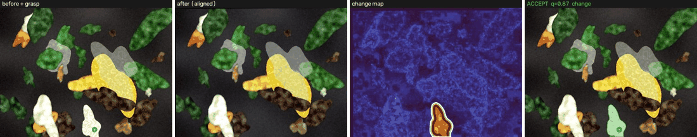
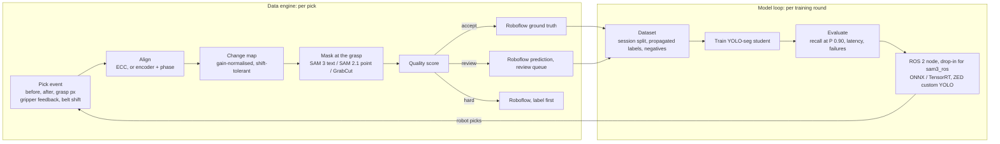

# PickLabel

**Every robot pick is a free training label.** PickLabel turns each pick (the frame before,
the frame after, the grasp pixel and the gripper's feedback) into a scored instance mask. It
routes the mask into Roboflow as ground truth, as a prediction for review, or as a hard example.
It then trains a fast YOLO-seg student on those labels (SAM 3 acts as the teacher once its
weights are available), and the student drops into a ROS 2 stack in place of `sam3_ros`.

**Live demo: [picklabel.vercel.app](https://picklabel.vercel.app)**. The real pipeline runs in your browser
(Pyodide + OpenCV, nothing to install). Click any item on a tray and watch it decide.



*Each pick: the item removed at the grasp point is found from the before/after difference,
masked, scored and routed. Four picks are accepted (IoU 0.84-0.97 with ground truth). One
grasp closes on nothing, so the frame becomes a HARD example: perception saw plastic that the
gripper couldn't find. Synthetic trays from `examples/`;
[single frame](docs/img/pick_accept.jpg), [missed grasp](docs/img/pick_missed.jpg).*

## Why this works

A sorting robot already does the expensive part of labelling: it finds a contaminant and
removes it. The pixels that changed between the before and after frames are that item, and the
grasp point says which change is the item and not a neighbour that got nudged. Gripper feedback
adds a free signal: a grasp that closes on nothing marks a frame where perception saw plastic
that wasn't there.



## Results so far

Everything below was measured with the code in this repo. Synthetic numbers check that the
pipeline is correct and show what each design choice is worth. They are **not** a claim about
real waste. Real-data rows stay empty until real data exists.

> **Headline (synthetic):** a student trained on PickLabel's labels, with **zero** human-labelled
> instances, matched a student trained on 352 ground-truth masks at recall @ precision 0.90
> (0.877 vs 0.863). It is weaker on mask tightness (AP50-95 0.714 vs 0.771).

### Auto-labeler on synthetic trays (37 picks + 1 missed grasp, exact masks)

| Mask source | mean IoU | IoU >= 0.75 | score vs IoU (Spearman) | time / pick (M1 laptop) |
|---|---|---|---|---|
| change map + GrabCut (no model) | **0.925** | 89% | 0.57 | 0.65 s (CPU) |
| SAM 2.1-tiny at the grasp (point + box + background clicks) | 0.903 | 86% | **0.78** | 3.4 s (MPS) |

On these clean synthetic textures the model-free mask is as good as SAM 2.1-tiny. SAM's value
shows up in the score: its agreement with the change region is independent evidence, so bad
masks score low and get routed to review.

* **Missed grasps caught:** 1 of 1 here and 4 of 4 on a larger 131-pick run, routed `hard`
  with `no_change_at_grasp, gripper_empty`.
* **Routing calibrated from data** (`picklabel eval-autolabel`): with SAM 2.1 the accept cutoff
  comes out at 0.83. 33 labels go straight in at mean IoU 0.925, and the 3 worst (mean IoU
  0.65) land in the review queue. See [calibration plot](report/autolabel/sam2_tiny/calibration.png).
* **Label propagation:** each frame's labels are completed with items picked later. Frame-level
  instance recall is 0.91 at 0.96 precision; 87% of frames are fully labelled.
* **Belt mode** (content moving 40-140 px, encoder off by ~2 px): 25/25 frames aligned, accepted
  labels at mean IoU 0.95. Picks whose item left the after frame are flagged
  `grasp_not_visible_after` instead of being guessed.

**What each piece is worth** (same 37 picks, [`scripts/ablate_autolabel.py`](scripts/ablate_autolabel.py)):

| Variant | mean IoU | IoU >= 0.75 | false-change area (median) |
|---|---|---|---|
| full pipeline | **0.925** | **89%** | 2.6% |
| no exposure / white-balance gains | 0.825 | 70% | 3.9% |
| no shift tolerance (nudged neighbours count as change) | 0.793 | 68% | 3.1% |
| neither | 0.607 | 39% | 13.8% |
| no GrabCut edge snapping | 0.780 | 76% | 2.6% |

### Student, synthetic smoke test

YOLO11n-seg, 40 epochs at 640 px on an M1 (MPS), evaluated on 73 plastic items in 8 held-out
sessions ([`scripts/synthetic_e2e.py`](scripts/synthetic_e2e.py)):

| Student | Training labels | Human-labelled instances | Recall @ P >= 0.90 | AP50 (mask) | AP50-95 (mask) | CPU ms / frame |
|---|---|---|---|---|---|---|
| R1 | ground-truth masks (stand-in for manual labels) | 352 | 0.863 | 0.916 | 0.771 | 58 |
| R2 | PickLabel accepted labels | 0 | 0.877 | 0.912 | 0.714 | 61 |

At the operating point a picking robot uses, the student trained on auto-labels **matches** the one
trained on ground truth. The +0.014 recall difference is one item out of 73, which is noise.
Where it loses is mask tightness: AP50-95 is 0.057 lower, because auto-label boundaries are a
few percent off (mean IoU 0.94). That is the gap the review pass (R3) and SAM-quality masks are
meant to close. R2 also trained on fewer frames (139 vs 161): incomplete and non-accepted frames
are dropped on purpose.

[PR curves](report/synthetic/pr_synthetic.png) · [recall vs human labels](report/synthetic/headline_synthetic.png) · [one-page report](report/results.md)

### Real data

| Model | Recall @ P >= 0.90 | AP50 (mask) | ms / frame (T4) | Human labelling minutes |
|---|---|---|---|---|
| SAM 3, `sam3_ros` default threshold 0.75 | – | – | – | 0 |
| SAM 3, tuned prompts + threshold | – | – | – | 0 |
| R1 student, manual labels | – | – | – | – |
| R2 student, PickLabel accepted | – | – | – | 0 |
| R3 student, PickLabel accepted + reviewed | – | – | – | – |

Filled by `picklabel sam3-baseline`, `eval-student` and `report` once the home-rig gold set and
SAM 3 weights are in place ([notebook](notebooks/picklabel_gpu.ipynb)).

## How it maps to Grip's stack

From Grip's public forks (details and commit references in [docs/grip_stack.md](docs/grip_stack.md)):

| Grip's stack | PickLabel |
|---|---|
| `sam3_ros` publishes real confidence scores (Grip's commit) at a fixed 0.75 threshold | SAM 3 run exactly as that node runs it; threshold and prompt sweep; recall @ P >= 0.90; duplicate detections across prompts counted |
| `sam3_ros` interface (lifecycle node, `Detection2DArray`, `DetectMaskArray`) | [`picklabel_ros`](ros2_ws/README.md): same parameters, topics and message conventions. `node_name:=sam3_node` makes it a literal drop-in |
| ZED with fixed exposure (Grip's commit), auto white balance still on | per-channel gain correction before differencing |
| belt tracking (ServoJ, nonzero-boundary-velocity cuRobo) | `belt` alignment from the encoder shift + phase correlation; `pick_logger_node` records it |
| impedance gripper with feedback | gripper-empty picks become hard examples; "empty but scene changed" is never auto-accepted |
| ZED custom YOLO ONNX path | `picklabel export --kind zed` writes the ONNX and the exact config block ([guide](export/zed_custom_yolo.md)) |
| Roboflow labelling | route-aware uploads: tags, metadata, review-queue predictions, idempotent ledger |

## Quickstart

```bash
git clone https://github.com/Waqar53/picklable.git && cd picklable
python -m venv ~/.venvs/picklabel && source ~/.venvs/picklabel/bin/activate   # outside iCloud-synced folders
pip install -e ".[all]"

make test                      # 33 tests, ~15 s, no weights needed
make demo                      # auto-label the bundled example picks
make app                       # Streamlit demo (also deployable as a Hugging Face Space)
python scripts/build_site.py --out build/site   # the live demo page; deploy: vercel deploy build/site --prod
```

**Your own picks** (phone above a tray, focus and exposure locked):

```bash
picklabel capture --source http://<phone-ip>:8080/video --out data/pairs   # b / click / a, c when cleared
picklabel autolabel data/pairs --out runs/autolabel/day1 --sam2 sam2.1_t.pt --dry-run
cp .env.example .env           # Roboflow key, workspace, project
picklabel autolabel data/pairs --out runs/autolabel/day1 --sam2 sam2.1_t.pt --push
picklabel eval-autolabel runs/autolabel/gold --out report/autolabel        # calibrate routing on the gold set
picklabel build-dataset runs/autolabel/day* --out datasets/R2 --routes accept
picklabel train --data datasets/R2/data.yaml --preset R2
picklabel eval-student --weights runs/train/R2/weights/best.pt --gt data/gold --out report/eval/R2 --latency
picklabel select-uncertain --weights runs/train/R2/weights/best.pt --images data/unlabelled --threshold 0.42 --k 100 --push
```

SAM 3 (gated weights) and GPU training run in [`notebooks/picklabel_gpu.ipynb`](notebooks/picklabel_gpu.ipynb)
on a free Colab/Kaggle T4. `picklabel --help` lists every stage. Public evaluation data:
`picklabel download ws2` (real conveyor, CC BY 4.0) and `picklabel download zerowaste-f`.

## Design notes

* **Change map.** Colour (delta-E) plus local-contrast terms, each taken as the minimum over
  small displacements, so a neighbour nudged by the pick doesn't light up. Absolute scales,
  never per-image percentiles, so a missed grasp gives an empty map. Per-channel gains first,
  because exposure and white balance act as channel gains.
* **Mask at the grasp.** SAM 3 text candidates at the grasp that explain the change region, else
  SAM 2.1 prompted with the grasp, the change box and background clicks sampled from unchanged
  pixels around the item, else the change region snapped to edges with GrabCut.
* **Quality score.** Agreement with the change region, share of strongly-changed pixels, change
  support, boundary contrast, shape sanity and source prior. Cutoffs are fitted on the gold set,
  not guessed.
* **Partial labels are poison.** A frame with one labelled bag and three unlabelled ones teaches
  the student that bags are background. Propagation copies later picks' masks back into earlier
  frames when their pixels didn't change; frames that stay incomplete are never auto-accepted.
* **Honest evaluation.** Splits by capture session, never by image. Recall at precision >= 0.90
  is the headline, not mAP: a missed bag ends up in compost, a false pick wastes a cycle. SAM 3
  and the students are scored by the same code.

## Repository

```
picklabel/autolabel/   align, change map, segmenters, selection, scoring, propagation, batch runner
picklabel/roboflow_sync/  COCO export, route-aware uploads
picklabel/train/       dataset builder (session split), copy-paste augmentation, YOLO-seg training
picklabel/eval/        metrics, SAM 3 baseline, student eval, calibration, failure gallery, thresholds, tiling
picklabel/deploy/      3D pick point from mask + depth, ONNX / ZED export
picklabel/data/        synthetic sessions, capture rig, dataset downloads
ros2_ws/               picklabel_ros: detector (sam3_ros drop-in), pick logger, replay; Dockerfile
site/                  live demo page: the same Python running in the browser (Pyodide), on Vercel
app/                   Streamlit demo        notebooks/  GPU notebook        docs/  stack notes, labelling guide
```

## What isn't tested

No ZED, no Fairino arm, no plant data. The ROS 2 node's code runs in tests against fake `rclpy`
and message modules (lifecycle, topics, every message field), but not yet on a real ROS 2 install
or Grip hardware. SAM 3 code
follows Grip's node exactly, but weights are gated and it has not been run here. All numbers
above are synthetic until the real-data table is filled.

MIT licence. WS2 is CC BY 4.0. ZeroWaste is CC BY-NC 4.0 (non-commercial).
