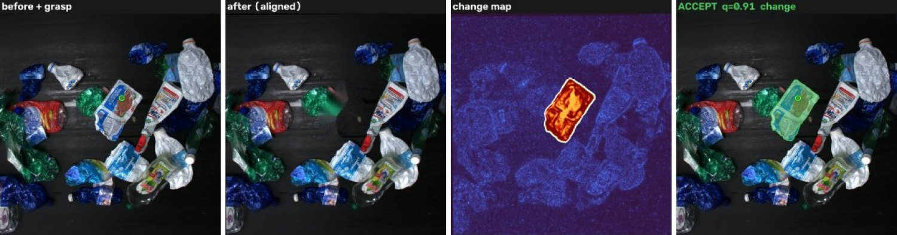
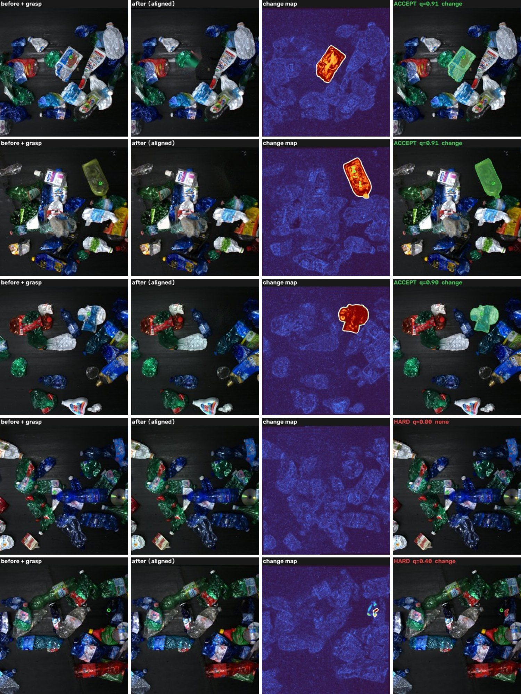
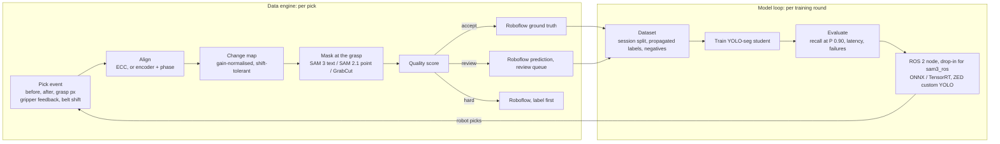

# PickLabel

**Every robot pick is a free training label.**

A waste-sorting robot already does the expensive part of labelling: it finds a contaminant,
grabs it and takes it away. PickLabel turns that into training data. From the frame before
the pick, the frame after it, the grasp point and the gripper's feedback, it produces a
pixel-accurate mask of what was removed. It scores the mask and sends it to Roboflow as ground
truth, as a prediction for a human to check, or as a hard example. It then trains a fast
YOLO-seg model on those labels and ships it as a drop-in replacement for the `sam3_ros` node in
a ROS 2 stack.

**Live demo: [picklabel.vercel.app](https://picklabel.vercel.app)**. The real pipeline runs in
your browser (Pyodide + OpenCV, nothing to install). Pick a frame from a real recycling plant,
click any item, and watch it decide.


*A real frame from a plastic-sorting conveyor (WS2 dataset). Green circle: where the gripper
closed. The change map shows what left the scene, and the mask is accepted at quality 0.91.*

## How accurate is it?

**On real recycling-plant images**: 120 picks on 120 real frames from 14 conveyor videos
([WS2](https://zenodo.org/records/14793518), CC BY 4.0), scored against the dataset's hand-made
masks:

| | Result |
|---|---|
| Mask accuracy (mean IoU with the hand-made mask) | **0.889**; 91% of picks at IoU ≥ 0.75, 98% at ≥ 0.5 |
| Missed grasps caught (gripper closed on nothing) | **21 / 21**, all routed as hard examples |
| Labels that go straight into the dataset (cutoffs fitted for 95% clean labels) | **88 of 99** (89%), at mean IoU **0.915** |
| Labels sent to a human | 11, mean IoU 0.67: exactly the weak ones |
| Does the quality score know when it's wrong? | Spearman 0.74 between score and true IoU |
| Speed | 0.8 s per pick on a laptop CPU, no GPU and no model weights |

**With SAM 2.1-tiny prompted at the grasp** (3.8 s per pick on a laptop GPU): mean IoU **0.917**, and **90 of 99**
labels go straight into the dataset at mean IoU **0.944**. It also fixes the clear-film failure below (IoU 0.33 → 0.93).

<details><summary>Both mask sources side by side</summary>

| Mask source | mean IoU | IoU >= 0.75 | IoU >= 0.5 | missed grasps caught | auto-accepted | sent to review | score vs IoU (Spearman) | time / pick |
|---|---|---|---|---|---|---|---|---|
| change map + GrabCut | 0.889 | 91% | 98% | 21/21 | 88/99 at IoU 0.915 | 11 at IoU 0.67 | 0.74 | 0.8 s |
| SAM 2.1-tiny at the grasp | 0.917 | 91% | 98% | 21/21 | 90/99 at IoU 0.944 | 9 at IoU 0.65 | 0.70 | 3.8 s |

</details>


*Top three: real picks, accepted with clean masks. Fourth: a missed grasp; nothing changed, so
the frame becomes a hard example. Fifth: the worst case in the set, a small dark item; the change
is too weak to trust, so PickLabel refuses it instead of guessing.*

**How this test works, honestly.** The frames, textures, lighting, translucent PET and clutter
are real, and so are the masks. WS2's before and after photos come from two cameras 2 m apart,
so they are not aligned pairs. The removal is therefore simulated: the item is inpainted out,
touching neighbours are nudged a few pixels in 20 of the 120 picks, and the scene is re-captured with
camera shake, exposure and white-balance drift, sensor noise and JPEG. 21 of the 120 picks are missed
grasps with nothing removed. Reproduce it with
[`scripts/ws2_removal_benchmark.py`](scripts/ws2_removal_benchmark.py) and
[`scripts/ws2_report.py`](scripts/ws2_report.py).

**Where it fails.** Clear film: removing a transparent bag changes its edges more than its
inside, so the change-only mask can come out as a ring. Very small dark items give too little
signal. Both score low and land in review or hard, not in the dataset. SAM 2.1's object shape fixes
the film case (IoU 0.33 → 0.93); tiny dark items stay refused.

**Training on the labels (synthetic trays, exact ground truth).** A YOLO11n-seg student trained
on PickLabel's labels, with **zero** human-labelled instances, matched one trained on 352
ground-truth masks at recall @ precision 0.90: **0.877 vs 0.863**, one item out of 73. It is
weaker on mask tightness (AP50-95 0.714 vs 0.771). Details are in [report/results.md](report/results.md).

## How it improves the robot's perception

1. **The model keeps learning from the plant it works in.** Every pick becomes a labelled image
   of the actual waste stream. A new packaging type, a new site or a season change shows up in
   the training data within a shift, without a labelling budget.
2. **Its own mistakes become training data.** A grasp that closes on nothing means perception
   saw plastic that wasn't there: an onion skin, wet paper, a reflection. PickLabel puts those
   frames at the top of the labelling queue, so precision improves exactly where the robot wastes
   cycles.
3. **People only see the uncertain 10%.** Routing cutoffs are fitted on a small gold set, so
   about 9 in 10 labels go straight into the dataset at IoU ~0.92 and humans review the rest.
4. **A faster, cheaper model on the robot.** The labels train a YOLO-seg student that replaces
   SAM 3's heavy one-pass-per-prompt inference (the nano model runs at about 60 ms per frame on a laptop CPU).
   It is evaluated where it matters: recall at a precision of 0.90, so few missed contaminants
   and few wasted picks.
5. **No changes downstream.** The student runs in a ROS 2 node with the same topics, messages and
   parameters as `sam3_ros`, so the pick logic and 3D localisation don't change.

## What PickLabel does, step by step



1. **Record the pick.** On the robot, `pick_logger_node` saves the frame before the arm enters,
   the frame after it leaves, the grasp pixel, the gripper's success flag and the belt shift. At
   home, `picklabel capture` does the same with a phone camera.
2. **Align the frames.** For a fixed scene, ECC with an ORB fallback. On a moving belt, the
   encoder shift is the starting guess and phase correlation refines it. Picks whose item left
   the after frame are flagged instead of guessed.
3. **Find what changed.** Colour and texture differences, after correcting the after frame's
   exposure and white balance. Each pixel takes the minimum over small shifts, so a neighbour
   nudged by the pick does not count as removed. Scales are absolute, so a missed grasp gives an
   empty map.
4. **Mask the item at the grasp point.** SAM 3 text candidates, else SAM 2.1 prompted with the
   grasp point, the change box and background clicks, else the change region snapped to image
   edges with GrabCut.
5. **Score and route it.** Agreement with the change region, strong-change share, support,
   boundary contrast, shape and source give a quality score. Cutoffs are fitted on a gold set.
   Gripper feedback overrides the pixels: "empty gripper + no change" is a hard example, and
   "empty gripper but the scene changed" (pushed, not picked) is never auto-accepted.
6. **Complete the labels.** A frame where one item is labelled and three aren't teaches the
   model that plastic is background. Masks of items picked later are copied back into earlier
   frames when their pixels didn't change.
7. **Train and judge the student fairly.** Splits are by capture session, never by image, so
   near-duplicate frames can't leak into the test set. Metrics are recall @ P ≥ 0.90, AP and
   latency, computed by the same code for SAM 3 and the student.
8. **Deploy and keep learning.** ROS 2 node, ONNX / TensorRT, or the ZED's custom-YOLO mode.
   The student then picks the most uncertain new frames for review (active learning).

## How to use it

**0. Install** (Python 3.10+):

```bash
git clone https://github.com/Waqar53/picklable.git && cd picklable
python -m venv ~/.venvs/picklabel && source ~/.venvs/picklabel/bin/activate   # outside iCloud-synced folders
pip install -e ".[all]"
make test                      # 34 tests, ~20 s, no weights needed
```

**1. See it work.** Open the [live demo](https://picklabel.vercel.app), or locally:

```bash
make demo                      # auto-label the bundled example picks (real conveyor + synthetic)
make app                       # Streamlit app
```

**2. Collect picks.** Choose one:

```bash
# on the robot (ROS 2): the pick executor publishes two JSON events per pick
ros2 run picklabel_ros pick_logger_node --ros-args -p image_topic_name:=/zed/zed_node/rgb/image_rect_color -p out_dir:=/data/picks
# with a phone or webcam over a tray: b = before, click the item, a = after
picklabel capture --source http://<phone-ip>:8080/video --out data/pairs
# from phone photos taken before/after/before/after...
picklabel import-photos ~/Pictures/run1 --out data/pairs && picklabel annotate data/pairs
```

**3. Auto-label and send to Roboflow:**

```bash
cp .env.example .env           # ROBOFLOW_API_KEY, ROBOFLOW_WORKSPACE, ROBOFLOW_PROJECT
picklabel autolabel data/pairs --out runs/autolabel/day1 --sam2 sam2.1_t.pt --dry-run   # preview the uploads
picklabel autolabel data/pairs --out runs/autolabel/day1 --sam2 sam2.1_t.pt --push
```

Each pick gets an image, a COCO file, a preview panel and a manifest line. Uploads carry tags
(`route:`, `source:`, `q:`, `session:`, `reason:`) and metadata, so Roboflow filters and dataset
versions can use them.

**4. Calibrate routing on a gold set** (about 50 frames with hand-made masks):

```bash
picklabel eval-autolabel runs/autolabel/gold --out report/autolabel --target-good-frac 0.95
```

**5. Train and evaluate the student:**

```bash
picklabel build-dataset runs/autolabel/day* --out datasets/R3 --routes accept,review
picklabel train --data datasets/R3/data.yaml --preset R3
picklabel eval-student --weights runs/train/R3/weights/best.pt --gt data/gold --out report/eval/R3 --latency
picklabel sam3-baseline --weights sam3.pt --gt data/gold --out report/sam3   # the bar to beat (GPU notebook)
```

**6. Deploy and close the loop:**

```bash
picklabel export --weights runs/train/R3/weights/best.pt --kind seg            # ONNX for the ROS 2 node
ros2 launch picklabel_ros picklabel.launch.py node_name:=sam3_node weight_file:=best.onnx
picklabel select-uncertain --weights best.pt --images data/unlabelled --threshold 0.42 --k 100 --push
```

The GPU parts (SAM 3, training on a T4) are in [`notebooks/picklabel_gpu.ipynb`](notebooks/picklabel_gpu.ipynb).
`picklabel --help` lists all 18 commands.

## Built against Grip's public stack

From Grip Robotics' public forks (commit references in [docs/grip_stack.md](docs/grip_stack.md)):

| What the forks show | What PickLabel does with it |
|---|---|
| `sam3_ros` publishes real SAM 3 confidence (Grip's commit); fixed 0.75 threshold; one pass per prompt | SAM 3 baseline run exactly as that node runs it: prompt × threshold sweep, recall @ P ≥ 0.90, cross-prompt duplicates counted |
| `sam3_ros` interface: lifecycle node, `Detection2DArray`, `DetectMaskArray` | [`picklabel_ros`](ros2_ws/README.md) with the same parameters, topics and fields; `node_name:=sam3_node` makes it a literal drop-in |
| ZED with exposure fixed (Grip's commit); auto white balance still on | per-channel gain correction before differencing |
| belt tracking (ServoJ) and cuRobo trajectories that start and end in motion | belt alignment from the encoder shift; the pick logger records it per pick |
| impedance gripper with feedback | "gripper empty" picks become hard examples |
| ZED custom-YOLO ONNX path | `picklabel export --kind zed` writes the ONNX and the exact config block ([guide](export/zed_custom_yolo.md)) |

## More results (synthetic trays, exact ground truth)

What each design choice is worth (37 picks, [`scripts/ablate_autolabel.py`](scripts/ablate_autolabel.py)):

| Variant | mean IoU | IoU ≥ 0.75 |
|---|---|---|
| full pipeline | **0.925** | **89%** |
| no exposure / white-balance gains | 0.825 | 70% |
| no shift tolerance (nudged neighbours count as change) | 0.793 | 68% |
| neither | 0.607 | 39% |
| no GrabCut edge snapping | 0.780 | 76% |

Student comparison (YOLO11n-seg, 40 epochs at 640 px, 8 held-out sessions, 73 items):

| Student | Training labels | Human-labelled instances | Recall @ P ≥ 0.90 | AP50 | AP50-95 | CPU ms / frame |
|---|---|---|---|---|---|---|
| R1 | ground-truth masks (stand-in for manual labels) | 352 | 0.863 | 0.916 | 0.771 | 58 |
| R2 | PickLabel accepted labels | 0 | 0.877 | 0.912 | 0.714 | 61 |

Belt mode (content moving 40–140 px, encoder off by ~2 px): 25/25 frames aligned, accepted labels
at mean IoU 0.95. Label propagation: frame-level instance recall 0.91 at 0.96 precision.
Everything is in [report/results.md](report/results.md), with
[PR curves](report/synthetic/pr_synthetic.png) and the [calibration plot](report/autolabel/sam2_tiny/calibration.png).

## Not tested yet

A real robot cell: a ZED, a Fairino arm, and real (not simulated) removals at a plant. The
ROS 2 node's code runs in tests against stand-in ROS modules (lifecycle, topics, every message
field), not yet on a real ROS 2 install. SAM 3 code follows Grip's node exactly, but the weights
are gated and it has not been run here. Next step: a slice of real pick logs.

## Repository

```
picklabel/autolabel/      align, change map, segmenters, selection, scoring, propagation, batch runner
picklabel/roboflow_sync/  COCO export, route-aware uploads
picklabel/train/          dataset builder (session split), copy-paste augmentation, YOLO-seg training
picklabel/eval/           metrics, SAM 3 baseline, student eval, calibration, failures, thresholds, tiling, active learning
picklabel/deploy/         3D pick point from mask + depth, ONNX / ZED export
picklabel/data/           synthetic sessions, capture rig, dataset downloads
ros2_ws/                  picklabel_ros: detector (sam3_ros drop-in), pick logger, replay; Dockerfile
site/                     live demo: the same Python running in the browser (Pyodide), on Vercel
scripts/                  benchmarks (real WS2 frames, synthetic end to end, ablation), site build
app/  notebooks/  docs/   Streamlit app, GPU notebook, stack notes and labelling guide
```

MIT licence. Real example frames: WS2 (Marelli et al., ICCV 2025 Workshops), CC BY 4.0. Item
removal is simulated as described above ([examples/ws2](examples/ws2/README.md)). ZeroWaste is
CC BY-NC 4.0.
