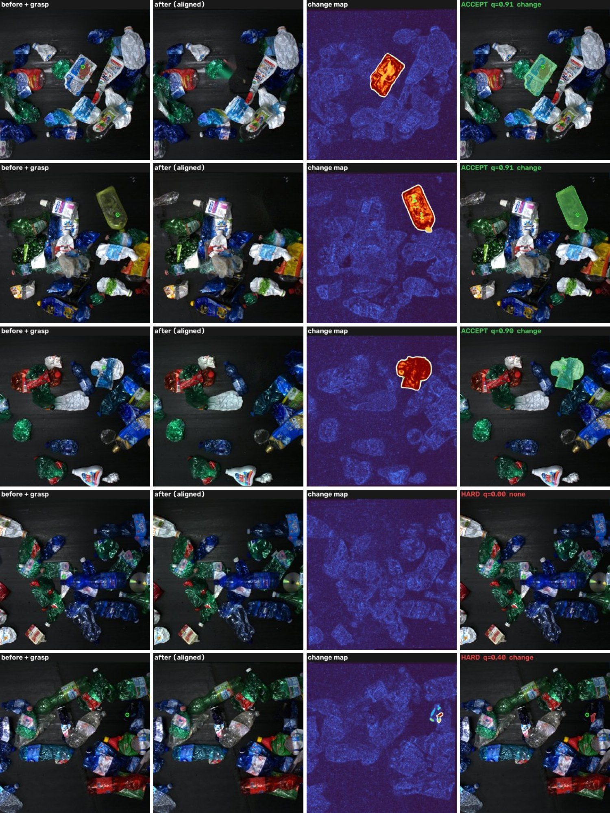
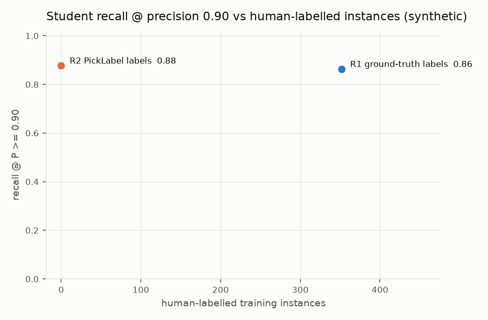

# PickLabel: results (one page)

All numbers come from code in this repo and from data that can be regenerated (`scripts/`).
Section 0 uses real recycling-plant images with a simulated removal. The synthetic sections are a
correctness and ablation test bench with exact ground truth. The last table needs real robot
pick logs.

## 0. Real recycling-plant frames (WS2, removal simulated)

120 picks on 120 real frames from 14 conveyor videos of a plastic-sorting plant
([WS2](https://zenodo.org/records/14793518), CC BY 4.0), scored against the dataset's hand-made
masks. One annotated item per frame is removed by inpainting; 20 picks also nudge touching
neighbours; the after frame is re-captured with shake, exposure / white-balance drift, noise and
JPEG; 21 picks are missed grasps with nothing removed (`scripts/ws2_removal_benchmark.py`,
`scripts/ws2_report.py`, outputs in `report/ws2/`).

| Mask source | mean IoU | IoU >= 0.75 | IoU >= 0.5 | missed grasps caught | auto-accepted | sent to review | score vs IoU (Spearman) | time / pick |
|---|---|---|---|---|---|---|---|---|
| change map + GrabCut | 0.889 | 91% | 98% | 21/21 | 88/99 at IoU 0.915 | 11 at IoU 0.67 | 0.74 | 0.8 s |
| SAM 2.1-tiny at the grasp | 0.917 | 91% | 98% | 21/21 | 90/99 at IoU 0.944 | 9 at IoU 0.65 | 0.70 | 3.8 s |

* Cutoffs fitted so 95% of auto-accepted labels reach IoU >= 0.75: 88 of 99 change-map labels go
  straight into the dataset at mean IoU 0.915 (SAM 2.1: 90 at 0.944); those sent to review average IoU 0.65-0.67.
* Failure modes: clear film (removal changes its edges more than its inside, so the change-only mask
  can come out as a ring; SAM 2.1 fixes it, IoU 0.33 -> 0.93) and very small dark items. Both score low.

## 1. The auto-labeler finds the picked item

Synthetic trays, 30 sessions / 131 picks with exact masks (`scripts/synthetic_e2e.py`):

* 123 picks auto-accepted at **mean IoU 0.938** (93% at IoU >= 0.75); 2 sent to review, 6 hard.
* **4 / 4 missed grasps caught** (`no_change_at_grasp` + `gripper_empty` -> hard example).
* With propagation, each frame's labels cover **93% of the plastic in view at 96% precision**,
  and 89% of frames are complete.

Separate 10-session set, mask source compared (`report/autolabel/`):

| Mask source | mean IoU | IoU >= 0.75 | score vs IoU (Spearman) |
|---|---|---|---|
| change map + GrabCut | 0.925 | 89% | 0.57 |
| SAM 2.1-tiny at the grasp | 0.903 | 86% | 0.78 |

With SAM 2.1 the calibrated cutoffs (accept >= 0.83, review >= 0.51) send the 3 worst masks
(mean IoU 0.65) to review and accept 33 at mean IoU 0.925.

## 2. What each design choice is worth

Same 37 picks, one change at a time (`scripts/ablate_autolabel.py`):

| Variant | mean IoU | IoU >= 0.75 | false-change area |
|---|---|---|---|
| full pipeline | **0.925** | **89%** | 2.6% |
| no exposure / white-balance gains | 0.825 | 70% | 3.9% |
| no shift tolerance | 0.793 | 68% | 3.1% |
| neither | 0.607 | 39% | 13.8% |
| no GrabCut edge snapping | 0.780 | 76% | 2.6% |

The first version matched LAB statistics instead of applying channel gains and differenced
pixel-to-pixel. It scored 0.60 mean IoU, with neighbours that slid a few pixels merging into
the pick region. Both fixes came from looking at the failures, not from tuning a threshold.

## 3. Belt mode

6 belt sessions, 25 picks, content moving 40-140 px between frames, encoder shift off by ~2 px:
25 / 25 aligned (encoder prior + phase correlation). 18 accepted at **mean IoU 0.951**; 2 in
review (IoU 0.51); 4 flagged `grasp_not_visible_after` because the belt had carried the item out
of the after frame. That last group tells the pick logger to grab the after frame earlier.

## 4. Student trained on PickLabel labels vs on ground truth (synthetic smoke test)

YOLO11n-seg, 40 epochs at 640 px on an M1 (MPS), evaluated on 73 plastic items in 8 held-out
sessions ([`scripts/synthetic_e2e.py`](../scripts/synthetic_e2e.py)):

| Student | Training labels | Human-labelled instances | Recall @ P >= 0.90 | AP50 (mask) | AP50-95 (mask) | CPU ms / frame |
|---|---|---|---|---|---|---|
| R1 | ground-truth masks (stand-in for manual labels) | 352 | 0.863 | 0.916 | 0.771 | 58 |
| R2 | PickLabel accepted labels | 0 | 0.877 | 0.912 | 0.714 | 61 |

At the operating point a picking robot uses, the student trained on auto-labels **matches** the one
trained on ground truth. The +0.014 recall difference is one item out of 73, which is noise.
Where it loses is mask tightness: AP50-95 is 0.057 lower, because auto-label boundaries are a
few percent off (mean IoU 0.94). That is the gap the review pass (R3) and SAM-quality masks are
meant to close. R2 also trained on fewer frames (139 vs 161): incomplete and non-accepted frames
are dropped on purpose.

## 5. Real data (to fill)

| Model | Recall @ P >= 0.90 | AP50 (mask) | ms / frame (T4) | Human labelling minutes |
|---|---|---|---|---|
| SAM 3, `sam3_ros` default threshold 0.75 | | | | 0 |
| SAM 3, tuned prompts + threshold | | | | 0 |
| R1 manual labels | | | | |
| R2 PickLabel accepted | | | | 0 |
| R3 PickLabel accepted + reviewed | | | | |

Needed: the home-rig gold set (50 hand-labelled frames), SAM 3 weights, a T4 (notebook).

## First two weeks with real pick logs

1. Measure before changing anything: run `sam3-baseline` on a few hundred logged frames, read
   off recall at P >= 0.90 and the duplicate rate across prompts, and see how far 0.75 is from
   the best threshold.
2. Attach `pick_logger_node` to one cell. Gripper feedback alone gives a failed-pick rate,
   and the hard examples land in Roboflow already tagged.
3. Train the first student on accepted + reviewed labels, run it next to SAM 3 on the same
   stream (same topics), and promote it only if it wins at the same precision.
